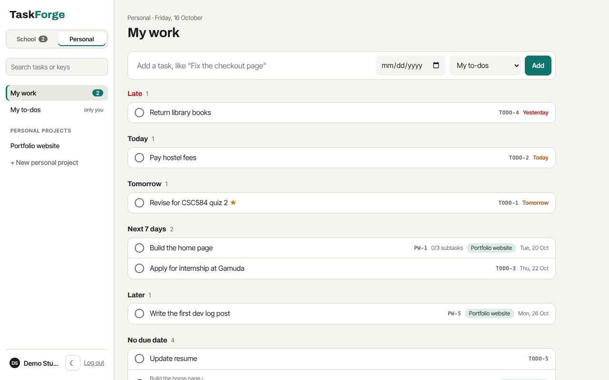
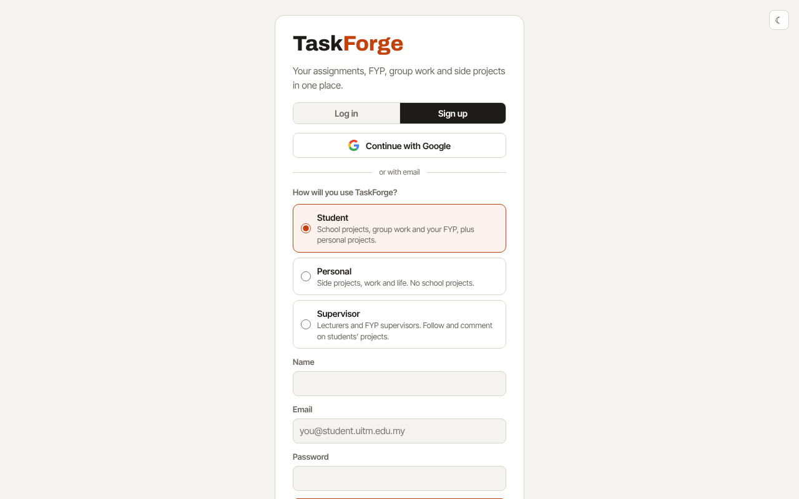
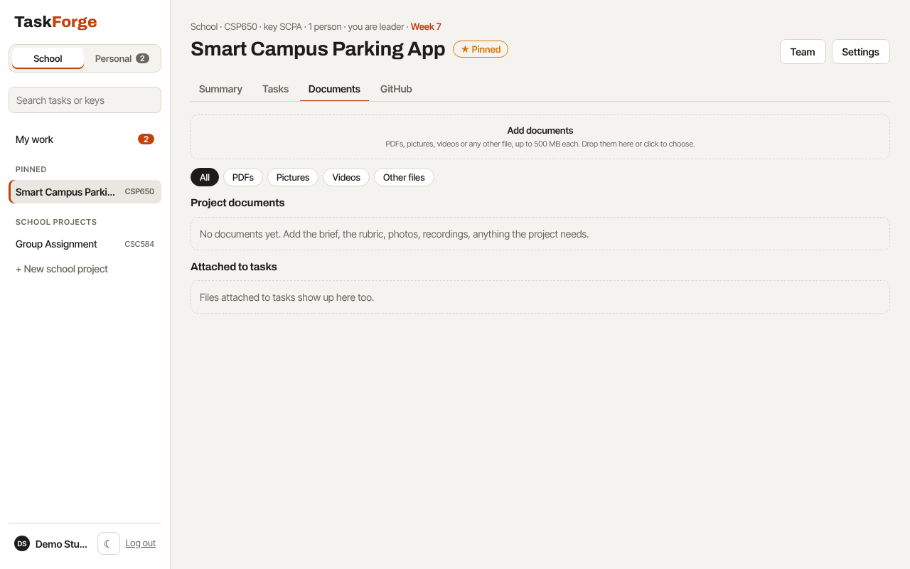
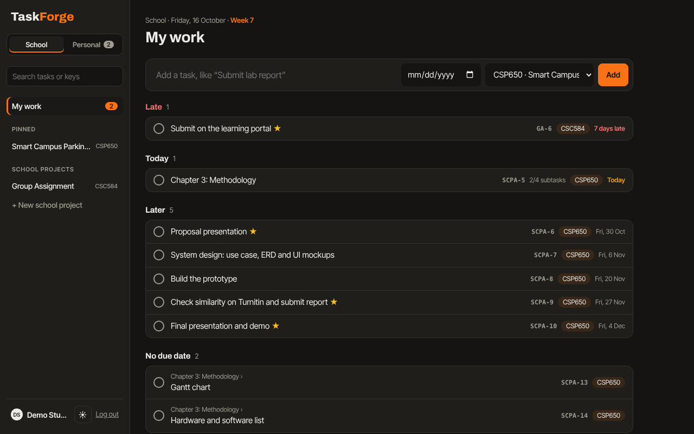
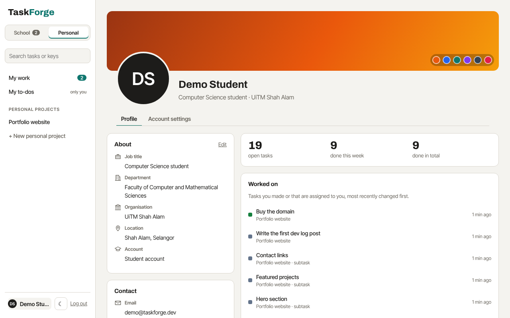
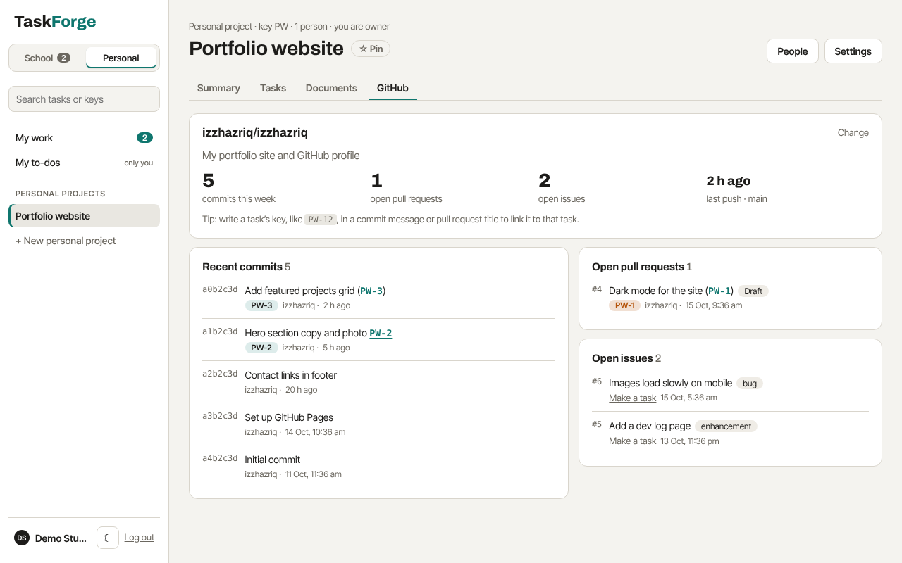

# TaskForge

One place for a university student's work: your group assignments, your Final Year Project (FYP), your own to-dos and the side projects you build outside class.

Students juggle personal deadlines, several group projects and an FYP at the same time, usually across WhatsApp groups, notes apps and spreadsheets. TaskForge puts it all in one list sorted by when it's due, and gives each group project a simple shared board that a supervisor can look at too.


## How it works

**Two spaces, School and Personal.** The switch at the top of the sidebar moves between them, and each has its own colour (orange for School, teal for Personal), its own projects and its own My work.
- **School** has your courses, group assignments and FYP. They show the course code and semester week, can start from a template, and can have a supervisor.
- **Personal** has your side projects, like a store website you're building, plus **My to-dos**, a private list only you can see, for things like paying hostel fees.



**My work** is the home screen of each space. It lists every task that's yours in that space, grouped into *Late*, *Today*, *Tomorrow*, *Next 7 days*, *Later* and *No due date*. Tick a task to finish it, or add one in a line. The other space's tab shows how many of its tasks are late or due today.

**Account types.** Sign-up asks how you'll use TaskForge:
- **Student**: both spaces, School and Personal.
- **Personal**: only the Personal space. Personal accounts can't join school projects.
- **Supervisor**: lecturers and FYP supervisors. They can only ever be a supervisor on school projects: they see the projects they're added to, comment and mark work as done, but don't make projects or do tasks. Their home screen lists those projects with how far along each one is.

You can change your account type in your profile's Account settings, as long as it fits the projects you're already in.



**Projects.** Pin the ones that matter most and they stay at the top of the sidebar. Everyone in a project has a role:
- **Leader** (in personal projects, **Owner**): sets up the project and adds people.
- **Member** (in personal projects, **Collaborator**): adds tasks, picks them up and finishes them.
- **Supervisor** (school projects only): can see everything, comment and mark work as done, but can't change it.

Each project has four sections:
- **Summary**: what the project is about and its goal (both editable), how many items are to do, doing and done, what's late, recent activity, and each person's workload.
- **Tasks**: three columns (*To do*, *Doing*, *Done*). Drag cards between them.
- **Documents**: PDFs, pictures, videos and any other files for the whole project, up to 500 MB each, plus every file attached to its tasks. Pictures, videos and PDFs open right in TaskForge. Filter by type, and watch big uploads with a progress bar.
- **GitHub**: link the project to a repository to follow the system you're building. It shows commits this week, the last push, recent commits, open pull requests and open issues. Turn an issue into a task with one click. Write a task's key, like `MBSW-12`, in a commit message or pull request title and it links to that task. The Summary also gets a small Code card.

**Task keys, like Jira's.** Every project has a short key made from its name (Medina Brand Store Website → `MBSW`; you can change it in Settings), and every task and subtask gets the next number in that project: `MBSW-1`, `MBSW-2`, and so on. Numbers are never reused, even after a task is deleted. Keys show on cards, in My work, on subtasks and in the task panel (click it to copy). Write a key anywhere TaskForge shows text you wrote, such as a comment or a task's notes, and it becomes a link that opens that task. Search for a key, like `MBSW-12`, to jump straight to it. Your My to-dos list uses `TODO`.

Leaders can clear a project's Recent activity from the Summary.




**Each task** opens in a side panel where you can:
- set a due date, see which semester week it falls in, and star it as important
- give it to someone in the group
- break it into **subtasks**, each with its own status, owner and due date. A subtask opens in its own panel, with a link back to its task
- attach files: PDF, Word, slides, Excel, images or ZIP, up to 10 MB each
- discuss it with the group or your supervisor


**Your profile** is laid out like Jira's: a cover colour, your photo, and your details (job title, department, organisation, location, about you) on the left, with the projects you're in. On the right are your task counts, the tasks you've worked on lately and your recent activity. **Account settings** has light or dark mode, your account type, a GitHub token, your email, password and photo. Click your name at the bottom of the sidebar to open it.

**Light and dark.** TaskForge follows your computer's setting until you choose. The ☾ / ☀ button beside your name switches it, and Account settings has the full choice.







## Made for Malaysian students

- **Semester weeks.** Tell TaskForge when Week 1 starts and it shows "Week 7" on the home screen and beside every due date.
- **Course codes** like `CSC584` label each project and show up beside its tasks in My work.
- **Ready-made starting points** for a group assignment (split the work, find references, write, combine, slides, submit, peer evaluation) and for an FYP (title and supervisor, Chapters 1 to 3, proposal presentation, design, prototype, Turnitin check, final presentation). Due dates follow the semester weeks.
- **Contributions report** for peer evaluation forms: tasks done, done on time, late, files shared and comments for each member.
- **Malaysian time (UTC+8)** decides what counts as "today" and "late".


## Tech stack

| Layer | Choice |
|---|---|
| Runtime | Node.js 22.5+ |
| Server | Express 4, REST + JSON |
| Database | SQLite via Node's built-in `node:sqlite` (no native build step) |
| Files | Stored on disk under random names, with details in SQLite |
| Auth | `scrypt` password hashing, random session tokens stored as SHA-256 hashes, HttpOnly cookies, optional Sign in with Google (OAuth 2.0) |
| GitHub | GitHub's REST API, read from the server and kept for a minute |
| Front end | Plain JavaScript, HTML and CSS, no build step |
| Tests | `node:test` integration tests against a real server and an in-memory database, run on GitHub Actions |

## Run it on your laptop

You need [Node.js](https://nodejs.org) 22.5 or newer.

```bash
npm install
npm start        # open http://localhost:3000 and sign up
```

Leave the terminal open while you use it, and press `Ctrl+C` to stop. Your tasks and files are saved in the `data` folder, so they're still there next time you run `npm start`.

### Try the demo first

```bash
npm run demo     # open http://localhost:3001
```

The demo has its own `demo-data` folder and resets every time you run it, so it never touches your real tasks. Every demo account uses the password `demo1234`:

| Email | Who |
|---|---|
| `demo@taskforge.dev` | A student with personal tasks, an FYP and a CSC584 group project |
| `aina@taskforge.dev` | A groupmate on CSC584 |
| `dr.nurul@taskforge.dev` | The FYP supervisor |

### Backups

While it runs, TaskForge saves a copy of its database once a day in `data/backups` and keeps the last 14. Run `npm run backup` to make one now. Attached files are in `data/uploads`. To back up everything, copy the whole `data` folder somewhere safe, such as Google Drive.

To restore a backup, stop TaskForge, replace `data/taskforge.db` with the backup file, and start it again.

### Updating

```bash
git pull
npm install
npm start
```

Your data is kept. If an update changes how the data is stored, TaskForge upgrades it on the next start and first saves a copy of the old version beside it, for example `data/taskforge.db.v3.bak`.

### Sign in with Google

The Google button only shows once you've set it up, which takes about five minutes:

1. Go to [Google Cloud Console → APIs & Services → Credentials](https://console.cloud.google.com/apis/credentials) and create a project if you don't have one.
2. Set up the **OAuth consent screen**: choose *External*, give it the name TaskForge and your email, and add yourself as a test user.
3. **Create credentials → OAuth client ID**, type *Web application*. Under *Authorised redirect URIs* add `http://localhost:3000/api/auth/google/callback`.
4. Make a file called `.env` next to `package.json` (copy `.env.example`) with the two values Google shows you:
   ```
   GOOGLE_CLIENT_ID=1234-abc.apps.googleusercontent.com
   GOOGLE_CLIENT_SECRET=GOCSPX-...
   ```
5. Restart TaskForge.

If you already have an account with the same email, signing in with Google links to it. Someone new picks Student, Personal or Supervisor first. Google accounts can set a password later in Account settings. `.env` is never committed.

### GitHub

Link a repository in a project's **Settings** (or its GitHub section) as `owner/name` or its github.com link. Public repositories work straight away. For private ones, add a fine-grained personal access token in **Profile → Account settings → GitHub** with read access to Contents, Issues and Pull requests. TaskForge uses your token, or the project leader's for everyone in the project. Tokens stay in your database and are never sent back to the browser.

Without a token GitHub allows about 60 checks an hour, which is plenty for one person since TaskForge keeps each answer for a minute.

### Which database?

TaskForge uses **SQLite**: the whole database is one file (`data/taskforge.db`) that's backed up daily, needs no server, and easily handles one person or a small group on one laptop. Keep it while TaskForge runs on your laptop.

If you later put TaskForge online so your groupmates and supervisor can use it from their own devices, move to **PostgreSQL**, for example on Supabase or Neon, both of which have free plans. The tables would stay the same; the queries in `src/` would move from `node:sqlite` to the `pg` package.

### Shortcuts

| Key | Does |
|---|---|
| `/` | Search all your tasks, by name or notes |
| `n` | Add a task |
| `Esc` | Clear the search |

Click your name at the bottom of the sidebar to open your profile.

### Settings

| Env var | Default | Purpose |
|---|---|---|
| `PORT` | `3000` (`3001` for the demo) | HTTP port |
| `DATA_DIR` | `data` | Where the database, files and backups are kept |
| `HOST` | `127.0.0.1` | Only your own computer can open it. Set to `0.0.0.0` to open it from your phone on the same Wi-Fi |
| `TZ_OFFSET_HOURS` | `8` | Hours from UTC used for "today" (Malaysia is 8) |
| `GOOGLE_CLIENT_ID`, `GOOGLE_CLIENT_SECRET` | none | Turns on Sign in with Google |
| `GOOGLE_REDIRECT_URI` | `http://localhost:PORT/api/auth/google/callback` | Change it if you open TaskForge at another address |

Put any of these in a `.env` file next to `package.json` and TaskForge reads it when it starts.

Run the tests with `npm test`.

## Project structure

```
src/
  server.js        Express app, routing, error handler, daily backups
  config.js        Where data is kept, demo mode
  db.js            Schema, upgrades, backups, transactions, personal lists
  backup.js        npm run backup
  files.js         Upload checks and downloads
  github.js        Reading a repository from GitHub
  auth.js          Password hashing, sessions, roles
  validate.js      Input validation helpers
  taskUtils.js     Creating tasks, Malaysian "today"
  templates.js     Group assignment and FYP starting points
  seed.js          Demo data
  routes/
    auth.js        Sign up, log in, Google sign-in, account details
    boards.js      Projects, summary, pins, documents, team, contributions
    tasks.js       My work, search, tasks, subtasks, files, comments
    users.js       Profile photos, profile overview, GitHub token
public/            The front end
test/              API tests
```

## Data model

```
users ──< memberships >── boards ──< tasks ──< tasks (subtasks, via parent_id)
  │                         │  │        ├────< attachments
  └──< pins >───────────────┘  │        └────< comments
                               ├──< documents
                               └──< activity
```

- A **board** is either a personal list (`personal = 1`, one per user, created at sign-up) or a project. A project's `kind` is `school` or `personal`.
- A **subtask** is a task whose `parent_id` points at another task on the same board. Subtasks only go one level deep.
- `memberships.role` is `owner` (leader), `member` or `supervisor`. A project always keeps at least one leader.
- `users.account_type` is `student`, `personal` or `supervisor`. Supervisor accounts can only be supervisors, personal accounts can't be in school projects, and personal projects have no supervisors.
- `boards.key` is the project's key and `boards.next_number` the number the next task gets. `tasks.number` is the task's number in its project, so its key is `key-number`.
- `boards.github_repo` is the linked repository (`owner/name`). `tasks.github_issue` records which issue a task was made from.
- Tasks on a personal list always belong to its owner. Project tasks can be given to any leader or member.
- `tasks.completed_at` is set when a task is finished, which powers "Done recently" and the on-time count.

## API

| Method | Path | Who | What |
|---|---|---|---|
| POST | `/api/auth/register`, `/login`, `/logout` | anyone | Accounts and sessions. Register takes `accountType` |
| GET | `/api/auth/google` → `/google/callback` | anyone | Sign in with Google |
| GET / POST | `/api/auth/google/pending`, `/google/complete` | after Google, new people | Pick an account type and make the account |
| GET / PATCH | `/api/auth/me` | signed in | Current user; change name, bio, job title, department, organisation, location, cover or account type |
| GET | `/api/me/overview` | signed in | Profile page: projects, tasks worked on, counts and activity |
| PUT / DELETE | `/api/me/github-token` | signed in | Save (checked with GitHub first) or remove your GitHub token |
| POST | `/api/auth/email` | signed in | Change email (needs your password) |
| PUT / DELETE | `/api/me/avatar` | signed in | Upload (raw PNG, JPG, GIF or WebP, up to 2 MB) or remove your photo |
| GET | `/api/users/:id/avatar` | signed in | Someone's photo |
| POST | `/api/auth/password` | signed in | Change password (signs out other browsers) |
| GET | `/api/search?q=` | signed in | Tasks in my personal list and projects matching a name or notes |
| GET | `/api/me/tasks` | signed in | My work: my open tasks everywhere, plus ones finished in the last day |
| GET | `/api/boards` | signed in | My personal list and projects |
| POST | `/api/boards` | signed in | Create a project, optionally from a template |
| GET | `/api/boards/:id` | anyone in it | The project, its team and tasks |
| GET | `/api/boards/:id/summary` | anyone in it | Status counts, recent activity and workload |
| PATCH | `/api/boards/:id` | leader; members may change `description`, `goal` and `goal_date` | Change the project |
| DELETE | `/api/boards/:id` | leader | Delete the project and its files |
| DELETE | `/api/boards/:id/activity` | leader | Clear the project's recent activity |
| GET | `/api/boards/:id/github` | anyone in it | Linked repository, commits, pull requests and issues |
| POST | `/api/boards/:id/github/issues/:number` | leader or member | Make a task from a GitHub issue |
| PUT / DELETE | `/api/boards/:id/pin` | anyone in it | Pin or unpin it for yourself |
| GET / POST | `/api/boards/:id/documents` | anyone in it / leader or member | List or add project documents (raw body streamed to disk, name in `X-Filename`, up to 500 MB, programs refused) |
| GET / DELETE | `/api/documents/:id` | anyone in it / uploader or leader | Download or delete a document. `?view=1` shows a picture, video or PDF in the browser, if the file's contents really are one |
| POST / PATCH / DELETE | `/api/boards/:id/members[/:userId]` | leader (or yourself, to leave) | Manage the team |
| GET | `/api/boards/:id/contributions` | anyone in it | Contributions report |
| POST | `/api/boards/:id/tasks` | leader or member | Add a task |
| GET | `/api/tasks/:id` | anyone in the project | Task with subtasks, files and comments |
| GET | `/api/tasks/by-key/:key` | signed in | Find a task by its key, like `MBSW-12`, in your projects |
| PATCH | `/api/tasks/:id` | leader or member; supervisors may change `status` only | Update a task |
| DELETE | `/api/tasks/:id` | leader or member | Delete a task |
| POST | `/api/tasks/:id/subtasks` | leader or member | Add a subtask (then use the task routes on it) |
| POST | `/api/tasks/:id/attachments` | leader or member | Upload: raw file body, name in the `X-Filename` header |
| GET / DELETE | `/api/attachments/:id` | anyone in it / uploader or leader | Download or delete a file |
| POST | `/api/tasks/:id/comments` · DELETE `/api/comments/:id` | anyone in the project | Discussion |

People outside a project get `404`, so the API doesn't reveal which projects exist.

## Ideas for next steps

- Bahasa Melayu interface
- Reminders by email or Telegram the day before something is due
- Malaysian public holidays and mid-semester break shown on the calendar
- A calendar view of the semester
- Put it online (with PostgreSQL) so groupmates and supervisors use it from their own devices

---

Built by [Izz Hazriq](https://izzhazriq.my).
