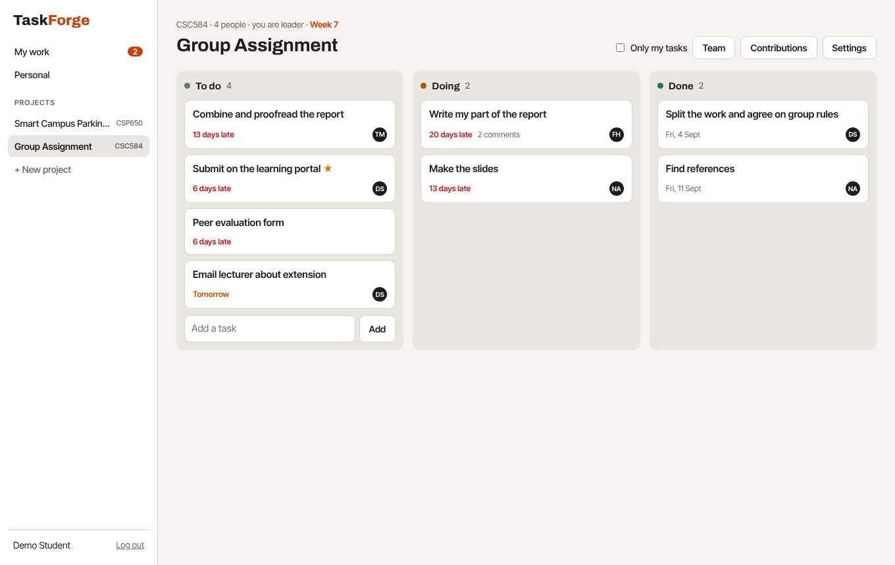

# TaskForge

One place for a university student's work: your own to-dos, your group assignments and your Final Year Project (FYP).

Students juggle personal deadlines, several group projects and an FYP at the same time, usually across WhatsApp groups, notes apps and spreadsheets. TaskForge puts it all in one list sorted by when it's due, and gives each group project a simple shared board that a supervisor can look at too.


## How it works

**My work** is the home screen. It lists every task that's yours, from your personal list and from every project, grouped into *Late*, *Today*, *Tomorrow*, *Next 7 days*, *Later* and *No due date*. Tick a task to finish it. Add a task in one line and choose whether it's personal or for a project.

**Personal** is your own private list, for things like revising for a quiz or paying hostel fees.

**Projects** are for group work. Each one has three columns (*To do*, *Doing*, *Done*) and a team:
- **Leader**: sets up the project and adds people.
- **Member**: adds tasks, picks them up and finishes them.
- **Supervisor**: a lecturer or FYP supervisor who can see everything, comment and mark work as done, but can't change it.



**Each task** opens in a side panel where you can:
- set a due date, see which semester week it falls in, and star it as important
- give it to someone in the group
- break it into steps
- attach files: PDF, Word, slides, Excel, images or ZIP, up to 10 MB each
- discuss it with the group or your supervisor


## Made for Malaysian students

- **Semester weeks.** Tell TaskForge when Week 1 starts and it shows "Week 7" on the home screen and beside every due date.
- **Course codes** like `CSC584` label each project and show up beside its tasks in My work.
- **Ready-made starting points** for a group assignment (split the work, find references, write, combine, slides, submit, peer evaluation) and for an FYP (title and supervisor, Chapters 1 to 3, proposal presentation, design, prototype, Turnitin check, final presentation). Due dates follow the semester weeks.
- **Contributions report** for peer evaluation forms: tasks done, done on time, late, files shared and comments for each member.
- **Malaysian time (UTC+8)** decides what counts as "today" and "late".


## Tech stack

| Layer | Choice |
|---|---|
| Runtime | Node.js 22.5+ |
| Server | Express 4, REST + JSON |
| Database | SQLite via Node's built-in `node:sqlite` (no native build step) |
| Files | Stored on disk under random names, with details in SQLite |
| Auth | `scrypt` password hashing, random session tokens stored as SHA-256 hashes, HttpOnly cookies |
| Front end | Plain JavaScript, HTML and CSS, no build step |
| Tests | `node:test` integration tests against a real server and an in-memory database |

## Run it locally

```bash
npm install
npm run seed     # optional: demo accounts, a personal list and two projects
npm start        # open http://localhost:3000
```

Every demo account uses the password `demo1234`:

| Email | Who |
|---|---|
| `demo@taskforge.dev` | A student with personal tasks, an FYP and a CSC584 group project |
| `aina@taskforge.dev` | A groupmate on CSC584 |
| `dr.nurul@taskforge.dev` | The FYP supervisor |

The demo semester is set so that today is in Week 7. Run the tests with `npm test`.

> Ran an older version? The database layout changed. Delete `taskforge.db` and run `npm run seed` again.

| Env var | Default | Purpose |
|---|---|---|
| `PORT` | `3000` | HTTP port |
| `DB_FILE` | `taskforge.db` | SQLite file path |
| `UPLOAD_DIR` | `uploads` | Where attached files are stored |
| `TZ_OFFSET_HOURS` | `8` | Hours from UTC used for "today" (Malaysia is 8) |
| `NODE_ENV` | | Set to `production` to mark cookies `Secure` (HTTPS only) |

## Project structure

```
src/
  server.js        Express app, routing and the JSON error handler
  db.js            Schema, transactions, personal lists
  auth.js          Password hashing, sessions, roles
  validate.js      Input validation helpers
  taskUtils.js     Creating tasks, Malaysian "today"
  templates.js     Group assignment and FYP starting points
  seed.js          Demo data
  routes/
    auth.js        Sign up, log in, log out
    boards.js      Projects, team, contributions
    tasks.js       My work, tasks, steps, files, comments
public/            The front end
test/              API tests
```

## Data model

```
users ──< memberships >── boards ──< tasks ──< steps
                                       ├────< attachments
                                       └────< comments
```

- A **board** is either a personal list (`personal = 1`, one per user, created at sign-up) or a project.
- `memberships.role` is `owner` (leader), `member` or `supervisor`. A project always keeps at least one leader.
- Tasks on a personal list always belong to its owner. Project tasks can be given to any leader or member.
- `tasks.completed_at` is set when a task is finished, which powers "Done recently" and the on-time count.

## API

| Method | Path | Who | What |
|---|---|---|---|
| POST | `/api/auth/register`, `/login`, `/logout` | anyone | Accounts and sessions |
| GET | `/api/auth/me` | signed in | Current user |
| GET | `/api/me/tasks` | signed in | My work: my open tasks everywhere, plus ones finished in the last day |
| GET | `/api/boards` | signed in | My personal list and projects |
| POST | `/api/boards` | signed in | Create a project, optionally from a template |
| GET | `/api/boards/:id` | anyone in it | The project, its team and tasks |
| PATCH / DELETE | `/api/boards/:id` | leader | Change settings or delete |
| POST / PATCH / DELETE | `/api/boards/:id/members[/:userId]` | leader (or yourself, to leave) | Manage the team |
| GET | `/api/boards/:id/contributions` | anyone in it | Contributions report |
| POST | `/api/boards/:id/tasks` | leader or member | Add a task |
| GET | `/api/tasks/:id` | anyone in the project | Task with steps, files and comments |
| PATCH | `/api/tasks/:id` | leader or member; supervisors may change `status` only | Update a task |
| DELETE | `/api/tasks/:id` | leader or member | Delete a task |
| POST | `/api/tasks/:id/steps` · PATCH/DELETE `/api/steps/:id` | leader or member | Steps |
| POST | `/api/tasks/:id/attachments` | leader or member | Upload: raw file body, name in the `X-Filename` header |
| GET / DELETE | `/api/attachments/:id` | anyone in it / uploader or leader | Download or delete a file |
| POST | `/api/tasks/:id/comments` · DELETE `/api/comments/:id` | anyone in the project | Discussion |

People outside a project get `404`, so the API doesn't reveal which projects exist.

## Ideas for next steps

- Bahasa Melayu interface
- Reminders by email or Telegram the day before something is due
- Malaysian public holidays and mid-semester break shown on the calendar
- A calendar view of the semester

---

Built by [Izz Hazriq](https://izzhazriq.my).
