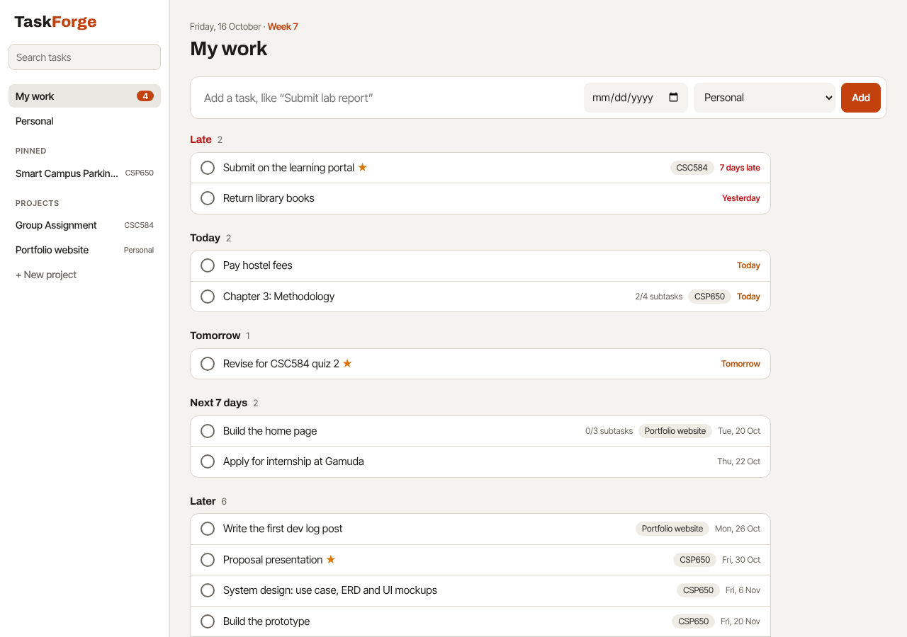
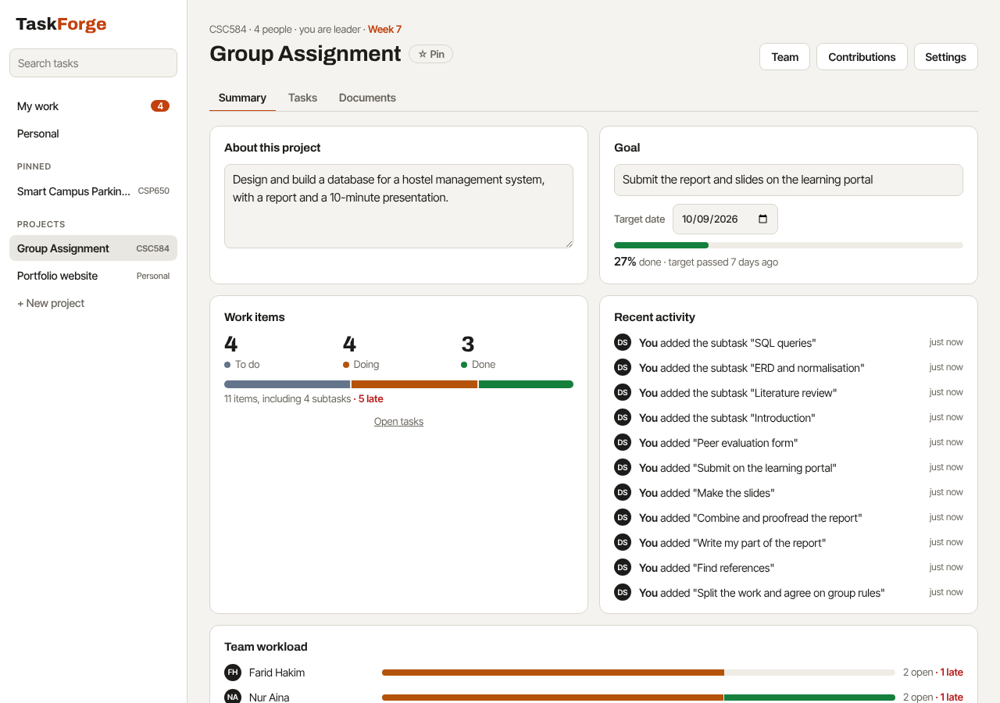
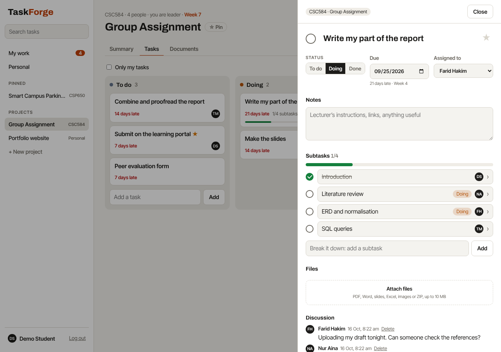
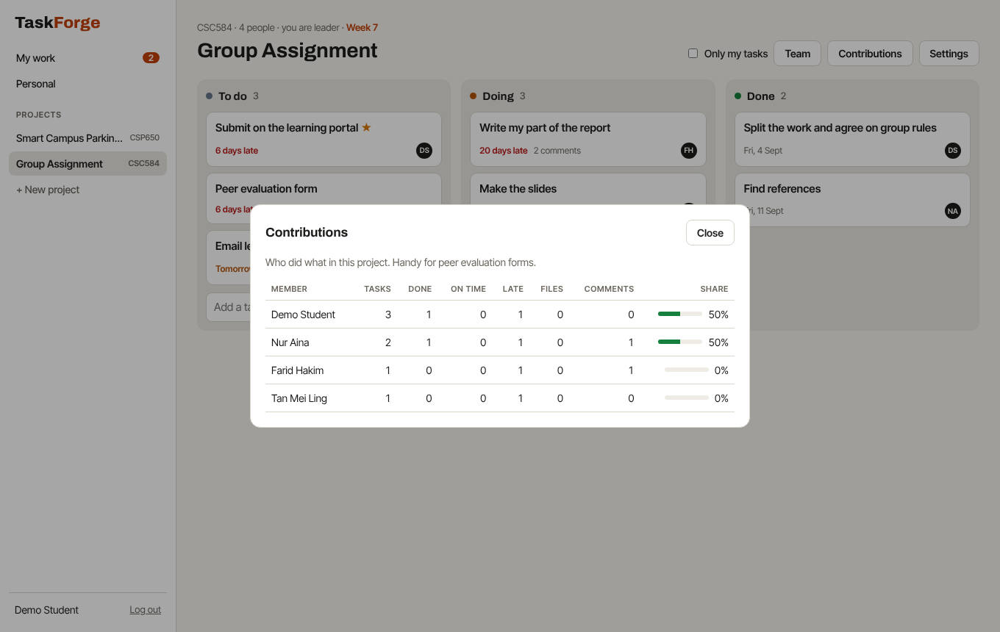

# TaskForge

One place for a university student's work: your own to-dos, your group assignments and your Final Year Project (FYP).

Students juggle personal deadlines, several group projects and an FYP at the same time, usually across WhatsApp groups, notes apps and spreadsheets. TaskForge puts it all in one list sorted by when it's due, and gives each group project a simple shared board that a supervisor can look at too.



## How it works

**My work** is the home screen. It lists every task that's yours, from your personal list and from every project, grouped into *Late*, *Today*, *Tomorrow*, *Next 7 days*, *Later* and *No due date*. Tick a task to finish it. Add a task in one line and choose whether it's personal or for a project.

**Personal** is your own private list, for things like revising for a quiz or paying hostel fees.

**Projects** are either **school** projects (a course, a group assignment, your FYP), which show the course code and semester week, or **personal** projects (a side project, a club, an event). Pin the ones that matter most and they stay at the top of the sidebar. Everyone in a project has a role:
- **Leader**: sets up the project and adds people.
- **Member**: adds tasks, picks them up and finishes them.
- **Supervisor**: a lecturer or FYP supervisor who can see everything, comment and mark work as done, but can't change it.

Each project has three sections:
- **Summary**: what the project is about and its goal (both editable), how many items are to do, doing and done, what's late, recent activity, and each person's workload.
- **Tasks**: three columns (*To do*, *Doing*, *Done*). Drag cards between them.
- **Documents**: files for the whole project, like the brief or the rubric, plus every file attached to its tasks.



**Each task** opens in a side panel where you can:
- set a due date, see which semester week it falls in, and star it as important
- give it to someone in the group
- break it into **subtasks**, each with its own status, owner and due date. A subtask opens in its own panel, with a link back to its task
- attach files: PDF, Word, slides, Excel, images or ZIP, up to 10 MB each
- discuss it with the group or your supervisor



**Your profile** has your photo, name, a short bio, your email and your password. Click your name at the bottom of the sidebar to open it.

## Made for Malaysian students

- **Semester weeks.** Tell TaskForge when Week 1 starts and it shows "Week 7" on the home screen and beside every due date.
- **Course codes** like `CSC584` label each project and show up beside its tasks in My work.
- **Ready-made starting points** for a group assignment (split the work, find references, write, combine, slides, submit, peer evaluation) and for an FYP (title and supervisor, Chapters 1 to 3, proposal presentation, design, prototype, Turnitin check, final presentation). Due dates follow the semester weeks.
- **Contributions report** for peer evaluation forms: tasks done, done on time, late, files shared and comments for each member.
- **Malaysian time (UTC+8)** decides what counts as "today" and "late".



## Tech stack

| Layer | Choice |
|---|---|
| Runtime | Node.js 22.5+ |
| Server | Express 4, REST + JSON |
| Database | SQLite via Node's built-in `node:sqlite` (no native build step) |
| Files | Stored on disk under random names, with details in SQLite |
| Auth | `scrypt` password hashing, random session tokens stored as SHA-256 hashes, HttpOnly cookies |
| Front end | Plain JavaScript, HTML and CSS, no build step |
| Tests | `node:test` integration tests against a real server and an in-memory database, run on GitHub Actions |

## Run it on your laptop

You need [Node.js](https://nodejs.org) 22.5 or newer.

```bash
npm install
npm start        # open http://localhost:3000 and sign up
```

Leave the terminal open while you use it, and press `Ctrl+C` to stop. Your tasks and files are saved in the `data` folder, so they're still there next time you run `npm start`.

### Try the demo first

```bash
npm run demo     # open http://localhost:3001
```

The demo has its own `demo-data` folder and resets every time you run it, so it never touches your real tasks. Every demo account uses the password `demo1234`:

| Email | Who |
|---|---|
| `demo@taskforge.dev` | A student with personal tasks, an FYP and a CSC584 group project |
| `aina@taskforge.dev` | A groupmate on CSC584 |
| `dr.nurul@taskforge.dev` | The FYP supervisor |

### Backups

While it runs, TaskForge saves a copy of its database once a day in `data/backups` and keeps the last 14. Run `npm run backup` to make one now. Attached files are in `data/uploads`. To back up everything, copy the whole `data` folder somewhere safe, such as Google Drive.

To restore a backup, stop TaskForge, replace `data/taskforge.db` with the backup file, and start it again.

### Updating

```bash
git pull
npm install
npm start
```

Your data is kept. If an update changes how the data is stored, TaskForge upgrades it on the next start and first saves a copy of the old version beside it, for example `data/taskforge.db.v3.bak`.

### Shortcuts

| Key | Does |
|---|---|
| `/` | Search all your tasks, by name or notes |
| `n` | Add a task |
| `Esc` | Clear the search |

Click your name at the bottom of the sidebar to open your profile.

### Settings

| Env var | Default | Purpose |
|---|---|---|
| `PORT` | `3000` (`3001` for the demo) | HTTP port |
| `DATA_DIR` | `data` | Where the database, files and backups are kept |
| `HOST` | `127.0.0.1` | Only your own computer can open it. Set to `0.0.0.0` to open it from your phone on the same Wi-Fi |
| `TZ_OFFSET_HOURS` | `8` | Hours from UTC used for "today" (Malaysia is 8) |

Run the tests with `npm test`.

## Project structure

```
src/
  server.js        Express app, routing, error handler, daily backups
  config.js        Where data is kept, demo mode
  db.js            Schema, upgrades, backups, transactions, personal lists
  backup.js        npm run backup
  files.js         Upload checks and downloads
  auth.js          Password hashing, sessions, roles
  validate.js      Input validation helpers
  taskUtils.js     Creating tasks, Malaysian "today"
  templates.js     Group assignment and FYP starting points
  seed.js          Demo data
  routes/
    auth.js        Sign up, log in, log out
    boards.js      Projects, summary, pins, documents, team, contributions
    tasks.js       My work, search, tasks, subtasks, files, comments
    users.js       Profile photos
public/            The front end
test/              API tests
```

## Data model

```
users ──< memberships >── boards ──< tasks ──< tasks (subtasks, via parent_id)
  │                         │  │        ├────< attachments
  └──< pins >───────────────┘  │        └────< comments
                               ├──< documents
                               └──< activity
```

- A **board** is either a personal list (`personal = 1`, one per user, created at sign-up) or a project. A project's `kind` is `school` or `personal`.
- A **subtask** is a task whose `parent_id` points at another task on the same board. Subtasks only go one level deep.
- `memberships.role` is `owner` (leader), `member` or `supervisor`. A project always keeps at least one leader.
- Tasks on a personal list always belong to its owner. Project tasks can be given to any leader or member.
- `tasks.completed_at` is set when a task is finished, which powers "Done recently" and the on-time count.

## API

| Method | Path | Who | What |
|---|---|---|---|
| POST | `/api/auth/register`, `/login`, `/logout` | anyone | Accounts and sessions |
| GET / PATCH | `/api/auth/me` | signed in | Current user, change name and bio |
| POST | `/api/auth/email` | signed in | Change email (needs your password) |
| PUT / DELETE | `/api/me/avatar` | signed in | Upload (raw PNG, JPG, GIF or WebP, up to 2 MB) or remove your photo |
| GET | `/api/users/:id/avatar` | signed in | Someone's photo |
| POST | `/api/auth/password` | signed in | Change password (signs out other browsers) |
| GET | `/api/search?q=` | signed in | Tasks in my personal list and projects matching a name or notes |
| GET | `/api/me/tasks` | signed in | My work: my open tasks everywhere, plus ones finished in the last day |
| GET | `/api/boards` | signed in | My personal list and projects |
| POST | `/api/boards` | signed in | Create a project, optionally from a template |
| GET | `/api/boards/:id` | anyone in it | The project, its team and tasks |
| GET | `/api/boards/:id/summary` | anyone in it | Status counts, recent activity and workload |
| PATCH | `/api/boards/:id` | leader; members may change `description`, `goal` and `goal_date` | Change the project |
| DELETE | `/api/boards/:id` | leader | Delete the project and its files |
| PUT / DELETE | `/api/boards/:id/pin` | anyone in it | Pin or unpin it for yourself |
| GET / POST | `/api/boards/:id/documents` | anyone in it / leader or member | List or add project documents |
| GET / DELETE | `/api/documents/:id` | anyone in it / uploader or leader | Download or delete a document |
| POST / PATCH / DELETE | `/api/boards/:id/members[/:userId]` | leader (or yourself, to leave) | Manage the team |
| GET | `/api/boards/:id/contributions` | anyone in it | Contributions report |
| POST | `/api/boards/:id/tasks` | leader or member | Add a task |
| GET | `/api/tasks/:id` | anyone in the project | Task with subtasks, files and comments |
| PATCH | `/api/tasks/:id` | leader or member; supervisors may change `status` only | Update a task |
| DELETE | `/api/tasks/:id` | leader or member | Delete a task |
| POST | `/api/tasks/:id/subtasks` | leader or member | Add a subtask (then use the task routes on it) |
| POST | `/api/tasks/:id/attachments` | leader or member | Upload: raw file body, name in the `X-Filename` header |
| GET / DELETE | `/api/attachments/:id` | anyone in it / uploader or leader | Download or delete a file |
| POST | `/api/tasks/:id/comments` · DELETE `/api/comments/:id` | anyone in the project | Discussion |

People outside a project get `404`, so the API doesn't reveal which projects exist.

## Ideas for next steps

- Bahasa Melayu interface
- Reminders by email or Telegram the day before something is due
- Malaysian public holidays and mid-semester break shown on the calendar
- A calendar view of the semester

---

Built by [Izz Hazriq](https://izzhazriq.my).
